  <picture>
  <source media="(prefers-color-scheme: dark)" srcset="https://raw.githubusercontent.com/BangJeongHyeok/BangJeongHyeok/output/github-bomber-dark.svg" />
  <source media="(prefers-color-scheme: light)" srcset="https://raw.githubusercontent.com/BangJeongHyeok/BangJeongHyeok/output/github-bomber.svg" />
  
</picture>

# 정혁 (Jeong Hyeok)
**Frontend / Game Developer** 🎮  
🌱 행복한 개발자입니다.  

---

### 🔧 Tech Stack

  
  
  
  

---

### 💼 Career
- **5Minlab** (2022 ~ )  
  _Unity 기반 게임 개발 및 라이브 서비스 운영_
- **PONY GAMES** (2020 ~ 2022)  
  _모바일 게임 클라이언트 개발_

---

### 📊 Github Stats

<!-- Total Commits & PRs -->

<!-- Top Languages -->

---

### 📨 Contact
- 📬 Email: idolphinbrain14@naver.com

